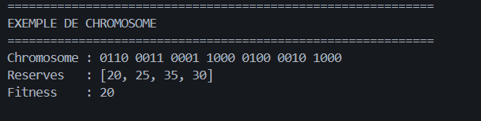
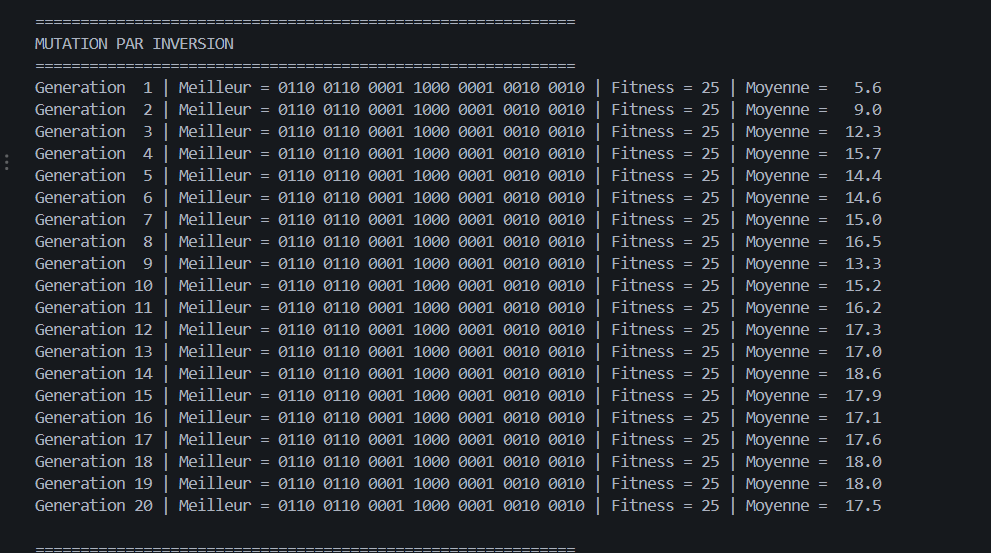
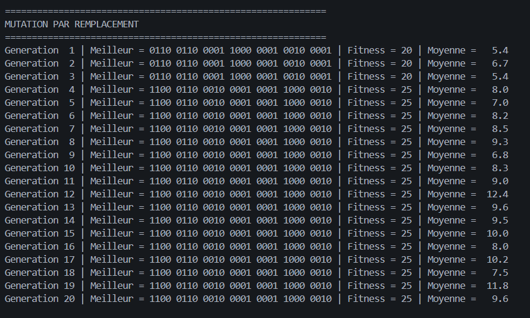
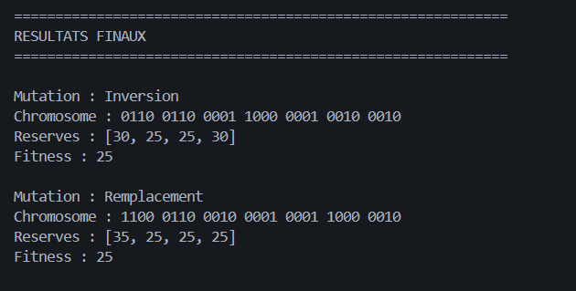
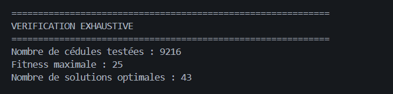

#  Optimisation d'une cédule de maintenance par algorithme génétique

## 1. Le problème

**7 centrales électriques** doivent être arrêtées pour maintenance
pendant l'année, répartie en **4 périodes**.

L'objectif est de déterminer quand arrêter chaque centrale afin de
conserver le maximum d'électricité en réserve pendant toutes les
périodes.

  Centrale                  1    2    3    4    5    6    7
  ---------------------- ---- ---- ---- ---- ---- ---- ----
  Puissance (MW)           20   15   35   40   15   15   10
  Durée de maintenance      2    2    1    1    1    1    1

-   **Puissance totale disponible :** 150 MW.
-   **Nombre de périodes :** 4.
-   **Besoins énergétiques :** 80, 90, 65 et 70 MW.

## 2. La formulation

La réserve électrique de chaque période est calculée par :

\[ R_t = 150 - P_{arret,t} - D_t\]

Où : - (P_{arret,t}) représente la puissance totale
des centrales en maintenance pendant la période (t). - (D_t) représente
le besoin énergétique de cette période.

**Contraintes :** - Les centrales 1 et 2 doivent être arrêtées pendant
deux périodes consécutives. - Les centrales 3 à 7 doivent être arrêtées
pendant une seule période. - La réserve doit être positive ou nulle pour
chaque période.

**Fonction objectif :**

Maximiser la réserve minimale parmi les quatre périodes :

\[ Fitness = `\max`{=tex}(0,`\min`{=tex}(R_1,R_2,R_3,R_4)) \]

Une solution est évaluée selon sa période la plus défavorable.

## 3. L'encodage

Chaque centrale est représentée par un gène de **4 bits**, correspondant
aux quatre périodes :

-   `1` : centrale arrêtée.
-   `0` : centrale en fonctionnement.

Les valeurs autorisées sont :

**Centrales 1 et 2 (maintenance de 2 périodes consécutives) :** -
`1100` - `0110` - `0011`

**Centrales 3 à 7 (maintenance d'une période) :** - `1000` - `0100` -
`0010` - `0001`

Un chromosome représente une solution complète composée de 7 gènes.

**Exemple :**

`0110 0011 0001 1000 0100 0010 1000`

Réserves obtenues : `[20, 25, 35, 30]`

Fitness : **20 MW**

### Capture 1 -- Exemple de chromosome

## 4. L'algorithme génétique

Les paramètres utilisés sont :

  Paramètre                     Valeur
  --------------------------- --------
  Taille de la population           42
  Nombre de générations             20
  Probabilité de croisement       80 %
  Probabilité de mutation         20 %
  Graine aléatoire                2026

Les différentes étapes de l'algorithme :

1.  **Population initiale :** génération aléatoire de 42 chromosomes
    respectant les contraintes du problème.
2.  **Sélection par loterie :** la probabilité de sélection d'un
    individu dépend de sa fitness. Plus sa fitness est élevée, plus ses
    chances d'être sélectionné sont importantes.
3.  **Croisement à un point :** deux parents échangent leurs parties
    après un point de coupure choisi aléatoirement.
4.  **Mutation :** deux méthodes sont étudiées.
5.  **Élitisme :** le meilleur individu de chaque génération est
    conservé directement dans la génération suivante.

### Les deux méthodes de mutation

**A. Mutation par inversion**

Une partie d'un gène est inversée. Le nouveau gène est accepté
uniquement s'il appartient aux valeurs autorisées.

Exemple : une inversion peut transformer `0001` en `0100`.

Si le résultat n'est pas autorisé, l'ancien gène est conservé.

**B. Mutation par remplacement**

Un gène est remplacé aléatoirement par une valeur appartenant à la liste
des valeurs autorisées pour la centrale concernée.

Dans les deux méthodes, les chromosomes restent valides et respectent
les contraintes de maintenance.

## 5. Les résultats obtenus

### A. Mutation par inversion

La méthode par inversion atteint une fitness de **25 MW dès la première
génération**.

La meilleure solution reste identique pendant les 20 générations grâce à
l'élitisme.

-   Meilleur chromosome : `0110 0110 0001 1000 0001 0010 0010`
-   Réserves : `[30, 25, 25, 30]`
-   Fitness : **25 MW**

#### Capture 2 -- Évolution avec la mutation par inversion

### B. Mutation par remplacement

La méthode par remplacement atteint une fitness de **25 MW à la
quatrième génération**.

La meilleure solution est ensuite conservée jusqu'à la dernière
génération.

-   Meilleur chromosome : `1100 0110 0010 0001 0001 1000 0010`
-   Réserves : `[35, 25, 25, 25]`
-   Fitness : **25 MW**

#### Capture 3 -- Évolution avec la mutation par remplacement

### C. Comparaison des deux méthodes

  Critère                                 Inversion   Remplacement
  ------------------------------------- ----------- --------------
  Première génération avec fitness 25             1              4
  Fitness finale                              25 MW          25 MW
  Nombre de générations                          20             20
  Réserve minimale finale                     25 MW          25 MW

Les deux méthodes trouvent des solutions optimales, mais avec des
chromosomes et des répartitions de réserves différents.

#### Capture 4 -- Résultats finaux

## 6. Vérification exhaustive

Afin de vérifier que la fitness obtenue est réellement optimale, une
recherche exhaustive a été réalisée.

Le nombre total de cédules possibles est :

\[ 3\^2 `\times 4`{=tex}\^5 = 9216 \]

Toutes les combinaisons autorisées sont testées et leur fitness est
calculée.

**Résultats :** - Nombre de cédules testées : **9 216** - Fitness
maximale : **25 MW** - Nombre de solutions optimales : **43**

Cette vérification confirme que **25 MW est la meilleure fitness
possible** pour ce problème.

Les deux méthodes de mutation permettent donc à l'algorithme génétique
de trouver une solution optimale.

### Capture 5 -- Vérification exhaustive

## 7. Conclusion

Ce travail permet de mettre en pratique les principales étapes d'un
algorithme génétique : génération de population, sélection par loterie,
croisement, mutation et élitisme.

La comparaison des deux méthodes de mutation montre qu'elles peuvent
conduire à des solutions différentes tout en atteignant la même fitness
optimale.

Enfin, la vérification exhaustive des 9 216 cédules possibles confirme
que la meilleure réserve minimale réalisable est de **25 MW**, avec 43
solutions optimales.
