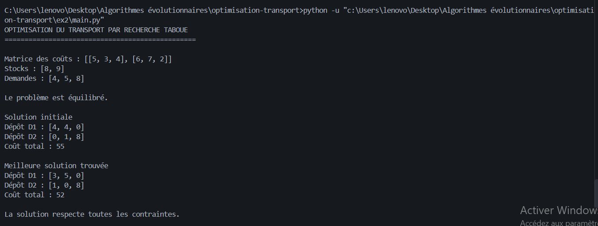

# Optimisation du transport par recherche taboue

 

## Présentation

Ce projet consiste à résoudre un problème de transport entre deux dépôts
et trois magasins à l'aide de la métaheuristique de recherche taboue.

L'objectif est de minimiser le coût total du transport tout en respectant
les stocks disponibles dans les dépôts et les demandes des magasins.

## Données du problème

| Dépôt | M1 | M2 | M3 | Stock |
|---|---:|---:|---:|---:|
| D1 | 5 | 3 | 4 | 8 |
| D2 | 6 | 7 | 2 | 9 |
| Demande | 4 | 5 | 8 | |

Le problème est équilibré : le stock total et la demande totale sont
tous deux égaux à 17.

## Méthode utilisée

Le programme commence par construire une solution initiale avec la méthode
du coin nord-ouest.

Ensuite, la recherche taboue génère des solutions voisines et sélectionne
celle qui présente le coût le plus faible parmi les solutions autorisées.
Une liste taboue permet de mémoriser les solutions récemment visitées.

Le programme conserve également la meilleure solution trouvée pendant
la recherche.

## Organisation du projet

- `problem.py` : données du problème.
- `utils.py` : calcul du coût et vérification des solutions.
- `tabu_search.py` : algorithme de recherche taboue.
- `main.py` : exécution du programme.
- `.gitignore` : fichiers exclus du dépôt Git.

## Exécution

Python 3 doit être installé.

Dans le terminal, exécuter :

```bash
python main.py
```

Aucune bibliothèque externe n'est nécessaire.

## Conclusion

Ce projet permet d'appliquer la recherche taboue à un problème
d'optimisation combinatoire et d'étudier son utilisation pour réduire
le coût total du transport.
