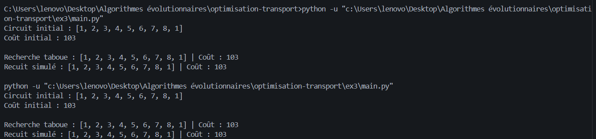

# Exercice 3 — Problème du voyageur de commerce

## Description

Ce projet consiste à résoudre un problème du voyageur de commerce (TSP) à l'aide de deux métaheuristiques :

- **Recherche taboue**
- **Recuit simulé**

Le problème comporte 8 villes. Chaque liaison possède un coût, et certaines liaisons sont interdites. L'objectif est de trouver un circuit valide minimisant le coût total, en visitant chaque ville une seule fois et en revenant à la ville de départ.

## Structure du projet

- `problem.py` : données du problème et circuit initial.
- `utils.py` : calcul du coût et vérification de la validité d'un circuit.
- `tabu_search.py` : implémentation de la recherche taboue.
- `recuit_simule.py` : implémentation du recuit simulé.
- `main.py` : exécution et comparaison des deux méthodes.

## Exécution

Python 3 est nécessaire. Aucune bibliothèque externe n'est requise.

Depuis le dossier du projet, exécuter :

```bash
python main.py
```

## Paramètres

- Circuit initial : `1-2-3-4-5-6-7-8-1`
- Recherche taboue : 5 itérations, taille de la liste taboue égale à 3.
- Recuit simulé : 5 itérations, température initiale empirique et facteur de refroidissement de 0.8.

## Résultats

Le programme affiche le coût du circuit initial, puis le meilleur circuit trouvé et son coût pour chaque méthode.

Les résultats peuvent varier selon les choix aléatoires effectués par le recuit simulé.
